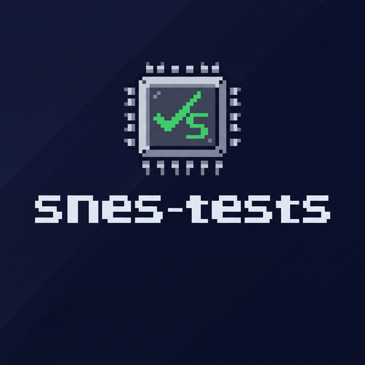
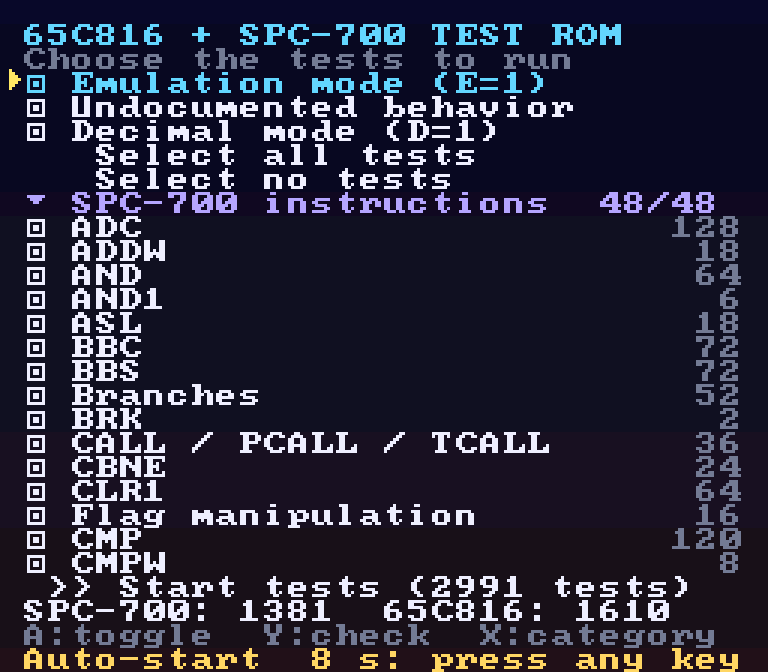
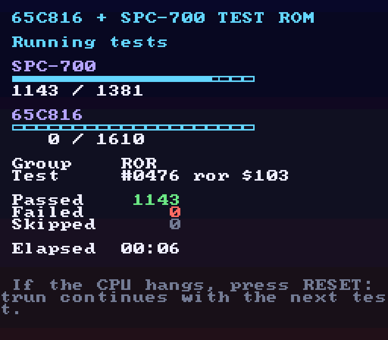
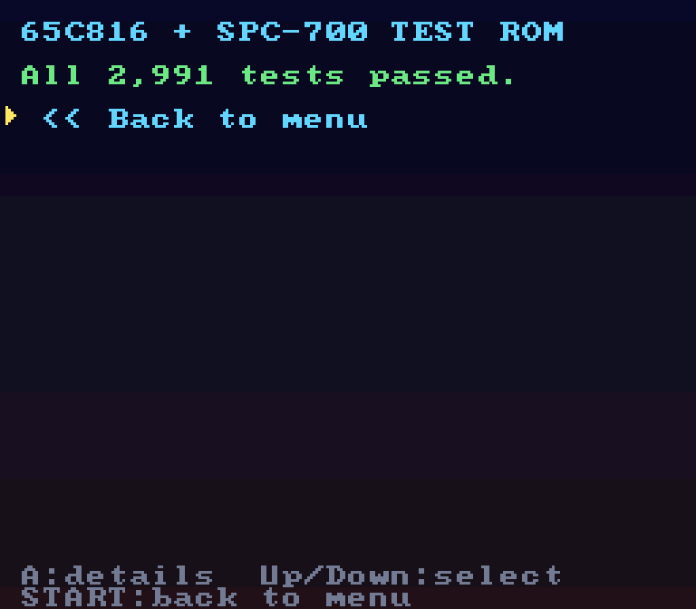
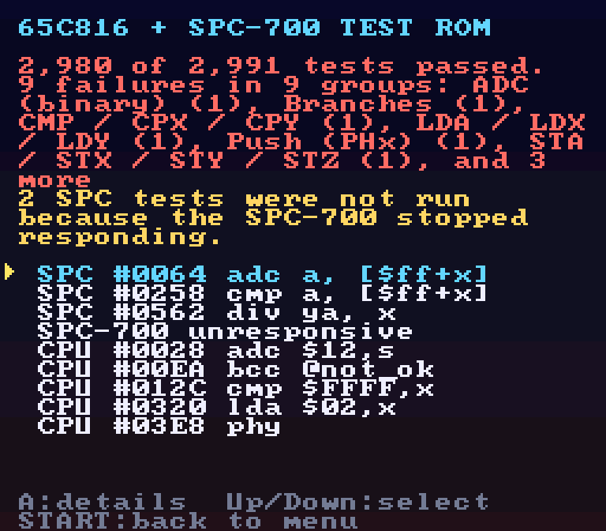
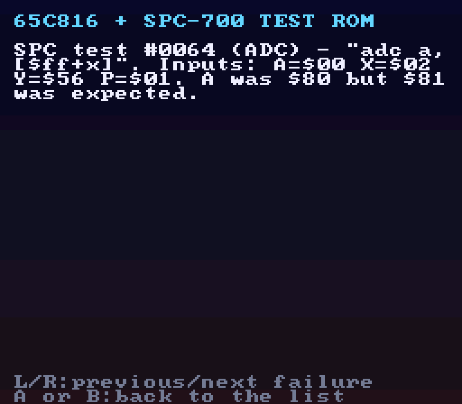

<p align="center">
  
</p>

<h1 align="center">snes-tests</h1>

<p align="center">
  <b>One ROM that tests the 65C816 and SPC-700 CPUs of the Super Nintendo, and tells you in plain English what failed.</b>
</p>

<p align="center">
  <a href="../../releases/latest"></a>
  
  
  <a href="LICENSE"></a>
</p>

<p align="center">
  
  
  
</p>

`snes-tests.sfc` runs **2,991 tests**: 1,610 for the 65C816 main CPU and 1,381 for the SPC-700 sound CPU. Pick
what to run from a menu, or let it start by itself. It runs everything in one go and ends with a report that
describes each failure in plain English. Use it to check an emulator, an FPGA core, a clone console or a real
SNES.

## What this fork adds

This is a fork of [gilyon/snes-tests](https://github.com/gilyon/snes-tests). The tests themselves are the same:
no expected value was changed. Everything around them was rewritten.

| | Original | This fork |
|---|---|---|
| ROMs | Three: `cputest-full`, `cputest-basic`, `spctest` | **One ROM** with both CPUs |
| Choosing tests | Pick the ROM | **Menu with a checkbox per instruction group**, plus filters for emulation mode, undocumented behavior and decimal mode |
| After a failure | Stops (press A to go on; the SPC test halts) | **Records it and keeps going**, unattended |
| Results | Register dump of the failing test | **Report in plain English**: summary, list of failures, and a detail page for each one |
| Hung test | Console stuck | **Recovers**: reset for the 65C816, automatic restart of the SPC-700 |
| Clone consoles | — | **Timing-tolerant SPC protocol**: every port read confirmed, timeouts, automatic resync |
| SPC-700 coverage | Instructions | Instructions **+ the APU I/O ports** and the port-clear bits of `$F1` |
| Hands-free runs | — | **Auto-start** after 10 s, for emulator test runners and CI |
| Verification | Manual | **Automated suite in Mesen2**: full run, menu, planted failures, garbage RAM, simulated protocol faults |

All tests pass on an original console, on two clone consoles and in Mesen2. The APU I/O port tests are the
newest group and have so far only been run in Mesen2.

## Using the ROM

### 1. Menu


At power on the menu lists every group of tests (one per instruction, or family of instructions) under
"SPC-700 instructions" and "65C816 instructions". **Everything is selected by default.**

| Button | Action |
|---|---|
| Up / Down | Move (L / R: a page) |
| A | Toggle the item; on a category, expand or collapse it |
| Y | Toggle the checkbox (on a category: all its groups) |
| X | Select or clear every group of the current category |
| Start | Run the selected tests, from anywhere in the menu |

Three filters at the top, all on by default:
- *Emulation mode (E=1)*: the 65C816 tests that run in emulation mode.
- *Undocumented behavior*: 65C816 behavior that the manuals don't describe, and the SPC-700 `DAA`, `DAS` and
  `DIV` groups.
- *Decimal mode*: 65C816 decimal arithmetic.

**Auto-start:** the first time the menu appears after power on, a 10-second countdown starts, then the tests run
with everything selected. Any button cancels it until the next power on. With nothing selected, "Start tests" is
grayed out.

<br clear="right">

### 2. Run


The SPC-700 tests run first, then the 65C816 tests. The screen shows the progress of each CPU, the group and
test in progress, how many tests passed, failed and were skipped, and the elapsed time. A failure doesn't stop
the run.

<br clear="right">

### 3. Report

<p>
  
  
</p>

The report starts with a summary, such as *"2,980 of 2,991 tests passed. 9 failures in 9 groups: …"*, followed by
the list of failures. Press A on a failure to see its detail:
- the test number, group and instruction;
- the mode: accumulator and index sizes, native or emulation;
- the inputs;
- the **first** check that failed, with the value found and the value expected.

For example: *"SPC test #0064 (ADC) - "adc a, [$ff+x]". Inputs: A=$00 X=$02 Y=$56 P=$01. A was $80 but $81 was
expected."*

"Back to menu" (or Start) returns to the menu with the same selection, so you can run again without a reset.
Tests are numbered in hexadecimal, as in the generated `*-tests.txt` files (`CPU #0123`, `SPC #0412`), which
describe every test in detail.

The screenshots above come from the debug build (`make debug`), which fails on purpose.

### If the console hangs

- **A 65C816 test that never finishes** can only be recovered by pressing **RESET**. The runner keeps its state in
  a part of WRAM that no test touches. After the reset it reports the test in progress as a hang and goes on with
  the next one. A power cycle starts from scratch.
- **An SPC-700 test that never finishes** is detected by the 65C816. It tells the SPC to go back to the IPL ROM,
  uploads the test program again and goes on with the next test.
  - A program that can't be uploaded is retried, and if it still fails, only its tests are skipped.
  - If the SPC stops answering altogether, the report says how many SPC tests didn't run, and the 65C816 tests run
    next.
- **Clone consoles:** the link with the SPC-700 tolerates different timing. Every port read is confirmed by a
  second read, every wait has a generous timeout, and the SPC can be told to restart when the two sides get out of
  step.
- A reset on the report or menu screen shows the menu again with the previous selection, without auto-start.

## Building

Requires [cc65](https://cc65.github.io/) (ca65/ld65), [spcasm](https://github.com/kleinesfilmroellchen/spcasm) and
Python 3.

```sh
make            # snes-tests.sfc (1 MB LoROM, no SRAM)
make check      # WRAM audit, generator tests, register-size check (no emulator needed)
make debug      # build-debug/snes-tests.sfc: some tests sabotaged on purpose
make test       # make check + every Mesen2 test below (needs MESEN=path/to/Mesen)
make package    # snes-tests.zip with the ROM
make clean
```

> spcasm 2.0.0 needs a nightly Rust toolchain from around its release date. For example:
> `rustup toolchain install nightly-2025-10-05 && cargo +nightly-2025-10-05 install spcasm --locked`.

Everything that is generated goes to `build/`, which git ignores: the test code, the tables used by the report,
the linker configuration, the `.spc` programs of the SPC-700 tests and the graphics.

### Testing the ROM itself

The ROM is tested headless in [Mesen2](https://www.mesen.ca/) (`--testrunner` and Lua). `tools/run_mesen.sh` runs
a ROM with `tools/lua/run_tests.lua`, which:
- lets the ROM auto-start;
- resets the console if a 65C816 test hangs;
- reads the failures from WRAM;
- exits with 0 if they match `expected-failures.txt`.

| Script | What it checks |
|---|---|
| `tools/run_mesen.sh` | Every test passes (or fails only as listed in `expected-failures.txt`) |
| `DIRTY_RAM=1 tools/run_mesen.sh` | The same, starting with garbage in WRAM like real hardware |
| `tools/lua/test_dirty_ram.lua` | The menu draws its text when WRAM starts with garbage |
| `tools/test_menu.sh` | Buttons, selection, filters and totals of the menu |
| `tools/test_spc_tolerance.sh` | Simulated protocol faults (a lost acknowledgment, a program that can't be uploaded) |
| `tools/test_debug_build.sh` | The planted failures of the debug build are reported exactly, with the expected text |
| `tools/lua/test_reset.lua` | A reset on the report keeps the selection and skips auto-start |

## Releases

Download the ROM from the [releases page](../../releases).

## How it works

See [`CLAUDE.md`](CLAUDE.md) for the architecture, the reserved WRAM layout, the protocol with the SPC-700 and the
rules that the tests follow. [`PLAN.md`](PLAN.md) has the plan of the rewrite and the decisions behind it. The
README files in [`cputest/`](cputest/README.md) and [`spctest/`](spctest/README.md) describe what each CPU test
covers.

## Credits

The original tests are by [gilyon](https://github.com/gilyon/snes-tests). The logo was generated with Google
Gemini. MIT License; see [`LICENSE`](LICENSE).
